<div align="center">

<!-- Hero Banner -->


<br/><br/>

<!-- Focus Highlights -->
<a href="https://github.com/DIVYANSH-GARG28">
  
</a>

<br/><br/>

<!-- Projects Grid -->


</div>

<br/>

---

### ✦ About & Core Focus

```text
┌─────────────────────────────────────────────────────────────────────────────┐
│  OPERATOR: Divyansh Garg           SPECIALIZATION: Automation & AI Systems  │
│  ACADEMIC: B.Tech CSE (8.16 CGPA)  STATUS: Open for Engineering Roles       │
│  DIRECTORY: github.com/DIVYANSH-GARG28                                      │
└─────────────────────────────────────────────────────────────────────────────┘
```

I approach engineering with a builder's mindset—turning manual operational friction into **resilient, event-driven automated workflows and context-grounded AI systems**.

My work focuses on structural reliability and deterministic design:
- **Pipeline Reliability:** Implementing automated regex sanitization and deduplication layers before CRM and database ingestion.
- **Context-Grounded Retrieval (RAG):** Indexing dense document embeddings into **ChromaDB** and **FAISS** with **n8n** orchestration to eliminate hallucinations.
- **Algorithmic Foundation:** Practicing continuous data structures and algorithms in **C++** with **200+ LeetCode problems solved**.

---

### ✦ Technical Arsenal

<div align="center">
  
</div>

<br/>

---

### ✦ Featured Engineering Systems

<table width="100%">
<tr>
<td width="50%" valign="top">
<h4>01 / connectED — Mentorship Knowledge Graph & SLA Bus</h4>
<p>
Distributed mentorship network combining a <b>FastAPI</b> backend with <b>Neo4j / NetworkX</b> graph traversal using the custom <b>KCD-v1 heuristic</b>. Orchestrates a <b>31 KB stateful n8n automation bus</b> over Telegram Bot API with a strict 48-hour response SLA escalation timer to eliminate orphaned student requests.
</p>
<p>
<code>FastAPI</code> • <code>Neo4j</code> • <code>NetworkX</code> • <code>n8n</code> • <code>Telegram API</code><br/>
📖 <a href="docs/connectED_README.md"><b>Read Architecture Deep-Dive →</b></a>
</p>
</td>
<td width="50%" valign="top">
<h4>02 / Knowledge Retrieval System — RAG & Vector Memory</h4>
<p>
End-to-end document question-answering architecture integrating <b>n8n</b>, dense text embeddings, and vector similarity search (<b>ChromaDB</b> & <b>FAISS</b>) with LLM APIs. Optimizes context chunking strategies and cosine distance thresholds to deliver strictly grounded context.
</p>
<p>
<code>Python</code> • <code>RAG</code> • <code>ChromaDB</code> • <code>FAISS</code> • <code>n8n</code> • <code>LLM APIs</code><br/>
<b>Document QA &amp; Context Pipeline</b>
</p>
</td>
</tr>
<tr>
<td width="50%" valign="top">
<h4>03 / APEX CONNECT AI — Autonomous Voice & Tool-Calling Agent</h4>
<p>
Browser-native voice assistant orchestrating <b>Qwen2-72B-Instruct</b> via Featherless AI. Transcribes input via native Web Speech Recognition, enforces structured JSON tool-calling schemas, and autonomously resolves temporal calendar collisions with synthesized voice feedback.
</p>
<p>
<code>Python</code> • <code>Flask</code> • <code>Qwen2-72B-Instruct</code> • <code>Web Speech API</code><br/>
<a href="https://github.com/DIVYANSH-GARG28/APEX_CONNECT_AI"><b>Repository</b></a> • 📖 <a href="docs/APEX_CONNECT_AI_README.md"><b>Read Architecture Deep-Dive →</b></a>
</p>
</td>
<td width="50%" valign="top">
<h4>04 / Node-Rover — ESP32 Autonomous Telemetry Rover</h4>
<p>
Autonomous edge rover powered by a <b>16 KB non-blocking C++ state machine</b> (<code>code.ino</code>). Hosts a local <b>Leaflet.js mapping HUD</b> in PROGMEM flash, integrates ultrasonic collision ranging, DHT11 environmental sensing, and hardware <b>SPI RFID token gating</b> with acoustic flame hazard lockout on ADC1.
</p>
<p>
<code>C++</code> • <code>ESP32 NodeMCU</code> • <code>Leaflet.js</code> • <code>VSPI Bus</code><br/>
<a href="https://github.com/DIVYANSH-GARG28/Node-Rover"><b>Repository</b></a> • 📖 <a href="docs/NODE_ROVER_README.md"><b>Read Architecture Deep-Dive →</b></a>
</p>
</td>
</tr>
<tr>
<td colspan="2" valign="top">
<h4>💼 Production Experience — Chess Gaja Operations</h4>
<p>
Technical operations & automation internship. Architected and deployed <b>15+ event-driven webhook pipelines</b> across CRM, web forms, and messaging gateways. Integrated automated deduplication and regex sanitization that reduced manual effort by <b>~80%</b> and slashed lead ingestion latency to <b><30s</b>.
</p>
<p>
<code>n8n</code> • <code>REST Webhooks</code> • <code>Zoho Bigin</code> • <code>Zoho Flow</code> • <code>Regex Filters</code><br/>
<b>Verified Industry Internship Impact</b>
</p>
</td>
</tr>
</table>

---

### ✦ Developer Profiles & Credentials

<table width="100%" border="0">
<tr>
<td width="50%" align="center" valign="middle">

<!-- daily.dev Card -->
<a href="https://dly.to/tIWmJTxLYvq" target="_blank">
  
</a>

</td>
<td width="50%" align="center" valign="middle">

<!-- LeetCode & Academic Credentials -->
<a href="https://leetcode.com/u/DivyanshGarg2/" target="_blank">
  
</a>

<br/><br/>

<a href="https://www.linkedin.com/in/divyansh-garg-305819271/" target="_blank">
  
</a>


<br/><br/>


</td>
</tr>
</table>

---

### ✦ Technical Arsenal Breakdown

| Domain | Stack & Protocols | Scope |
| :--- | :--- | :--- |
| **Core Languages** | `Python 3.9+`, `C++ (DSA & OOP)`, `SQL (MySQL)`, `JavaScript (ES6+)` | Asynchronous APIs, object-oriented systems, algorithmic problem solving |
| **Workflow Automation** | `n8n Orchestration`, `Webhook Gateways`, `Zoho Bigin CRM`, `Zoho Flow` | 15+ event-driven pipelines, automated deduplication, regex validation, SLA routing |
| **RAG & Vector Memory** | `RAG Architecture`, `ChromaDB`, `FAISS`, `Text Embeddings`, `LLM APIs` | End-to-end document QA, context chunking, cosine distance thresholds, prompt chaining |
| **Cloud & Systems** | `AWS Solutions Architect (Associate)`, `FastAPI`, `Flask`, `Docker`, `Git` | Cloud infrastructure patterns, REST microservices, containerization, version control |
| **Edge Hardware** | `ESP32 NodeMCU-32S`, `SPI (VSPI)`, `MFRC522 RFID`, `ADC1 Interlocks` | Real-time sensor fusion, embedded flash web HUDs, non-blocking C++ state machines |
| **Problem Solving** | `LeetCode (200+ Solved)`, `Data Structures & Algorithms in C++` | Graph traversal, dynamic programming, two pointers, binary search, trees |

---

### ✦ Activity & Telemetry

<div align="center">

  

  <br/><br/>

  
  

</div>

---

### ✦ Connect

<div align="center">

[](https://www.linkedin.com/in/divyansh-garg-305819271/)
[](https://dly.to/tIWmJTxLYvq)
[](https://leetcode.com/u/DivyanshGarg2/)
[](mailto:divyanshgarg28@gmail.com)
[](https://github.com/DIVYANSH-GARG28)

<br/>

<sub>Divyansh Garg • B.Tech CSE (8.16 CGPA) • Dr. A.P.J. Abdul Kalam Technical University</sub>

</div>